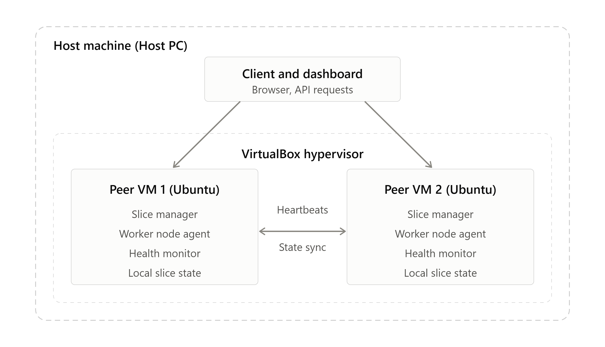

# Distributed Computing Group 4

## Distributed Network Slicing Platform
Network slicing is a way of carving one physical network into several independent virtual networks (“slices”), each tuned for a specific kind of traffic or customer. A network slicing platform is the software system that creates, configures, runs, and monitors those slices.

# The Classic 5G Slice Categories
eMBB (enhanced mobile broadband): high throughput, e.g. video, AR/VR
URLLC (ultra-reliable low-latency): e.g. industrial control, autonomous vehicles, telemedicine
mMTC (massive machine-type communication): huge numbers of low-power IoT devices

# Functions of a Slicing Platform

1. Slice definition and templates. Operators or tenants describe what they need (bandwidth, latency, reliability, device count, coverage area), often as a service-level agreement or a blueprint.
3. Orchestration. It translates that request into concrete resources: virtual network functions, compute, bandwidth allocations, and routing across the radio, transport, and core domains. This usually builds on NFV (network function virtualization) and SDN (software-defined networking).
4. Resource allocation and admission control. It decides whether there’s enough capacity to accept a new slice without breaking existing ones, and allocates or reallocates resources as demand shifts.
5. Isolation. It ensures a congested or compromised slice doesn’t degrade the others.
6. Monitoring and assurance. It continuously measures things like latency, throughput, and packet loss per slice, compares them against the Service Level Agreement (SLA), and triggers corrective action (scaling up, rerouting, reallocating) when targets are missed.
7. Lifecycle management. Creating, modifying, scaling, and tearing down slices over time.

# Typical architecture
Most designs have a layered structure: a northbound interface where tenants request slices, a slice management and orchestration layer in the middle and domain controllers underneath that actually configure the RAN, transport, and core.

# In a distributed setting

When the platform itself is distributed, the orchestration and control logic is spread across multiple nodes rather than sitting in one central controller. That brings its own challenges: keeping slice state consistent across nodes, coordinating resource decisions without a single point of failure, handling node failures gracefully, and keeping control-plane latency low. Those are the interesting distributed-systems problems behind it.

 ## Milestone 1 – Distributed Operating System Foundation 
## What This Tests  
• Understanding of distributed versus network operating systems  
Distributed OS presents multiple machines as one unified system with global process and resource control while Network OS allows independent machines share resources while each keeps its own local OS.
• Understanding of process management
Each slice is made of running pieces of software: virtual network functions, controllers, monitors, and schedulers. Those processes live on different nodes (servers, edge sites, core data centers). Process management is about starting them, keeping them running, and stopping them correctly. 
Process management is the system’s way of deciding where processes run, making them cooperate across nodes, keeping them alive when things fail, and sharing resources fairly between slices.
# What it involves
i.) Creation and placement. When a slice is requested, the system spawns the needed processes and decides which node runs each one, based on free CPU and memory, location, and latency needs.
ii.) Scheduling. Processes from different slices compete for the same hardware. The scheduler gives each slice its fair or guaranteed share, so a high-priority slice (say, emergency traffic) gets resources first.
iii.) Communication. Processes on different nodes talk through message passing or remote procedure calls (RPC), since they can’t share memory. This is how a controller tells a network function to change its settings.
iv.) Synchronization and coordination. Processes must agree on shared facts, like which node is the leader or what the current slice configuration is. Techniques include leader election and consensus (Raft, Paxos) and distributed locks.
v.) Monitoring and fault handling. The system watches each process with heartbeats. If one crashes or a node goes down, it restarts the process elsewhere (failover) so the slice keeps meeting its performance targets.
vi.) Scaling and migration. When load rises, it starts more copies of a process (scale out). It can also move a running process to another node to balance load or reduce latency.
vii.) Termination and cleanup. When a slice is deleted, its processes are stopped and the resources are freed for others.

# Resource allocation 
In a distributed network slicing system means deciding how much of the shared hardware (bandwidth, CPU, memory, radio capacity) each slice gets, and doing it across many nodes instead of one.

# What the resources are
Radio resources: spectrum and base station capacity
Transport resources: link bandwidth between sites
Compute resources: CPU, memory, and storage at edge and core data centers

# What it involves

1. Capacity tracking. Each node reports what it has free. The system keeps a picture of total available resources across the network.
2. Admission control. When a new slice is requested, the system checks if there’s enough capacity to meet its needs without hurting existing slices. If not, it rejects the request or negotiates.
3. Allocation. Resources are assigned to each slice according to its requirements. A low-latency slice might get dedicated capacity at the nearest edge node, while a streaming slice gets a large bandwidth share.
4. Isolation. Each slice gets a protected share, so one slice using too much cannot starve the others.
5. Dynamic adjustment. Demand changes, so allocations are resized on the fly. Unused resources are given to slices that need them, and taken back when the owner needs them again.
6. Fairness and priority. When resources run short, rules decide who gets what. Emergency or high-priority slices come first, and others share what remains fairly.
7. Optimization. Algorithms try to use resources efficiently, for example by minimizing cost, energy use, or latency while still meeting each slice’s service level agreement (SLA).

# Constructing the first distributed prototype
• Nodes - Windows host PC, 2 Linux-Ubuntu virtual machines.   
• Processes - Slices creation and placement, scheduling, communication, synchronization and coordination, fault handling and monitoring, scaling and migration, termination and cleanup.
• Resources - ink bandwidth between sites, CPU, memory, and storage at edge and core data centers.  
• Communication mechanisms - HTTP(REST) 

 # Operating-system responsibilities 
1. Process and thread management. It creates, schedules, and ends the processes that run network functions, giving each CPU time according to priority. A urgent slice gets scheduled first.
2. Memory management. It gives each process its own protected memory, so one slice’s software cannot read or corrupt another’s.
3. Resource isolation and control. Using tools like containers, cgroups, and namespaces (or virtual machines), it limits how much CPU, memory, and bandwidth each slice can use. This is what makes slice isolation real on a single node.
4. Networking support. It runs the network stack: sockets, packet handling, virtual interfaces, and traffic shaping and queuing, so each slice’s traffic is separated and meets its latency and bandwidth targets.
5. Inter-process communication. It provides ways for processes to exchange data, locally (pipes, shared memory) and across nodes (sockets, RPC, message queues).
6. Storage and file management. It stores slice configurations, logs, and state, and keeps them consistent and recoverable.
7. Security and access control. It enforces permissions, authenticates users and services, and protects slices from unauthorized access or attack.
8. Monitoring and fault handling. It exposes metrics (CPU, memory, network usage), detects crashed processes, and supports restart or recovery.
9. Hardware abstraction. It hides hardware details behind drivers and a standard interface, so the same slice software runs on different machines. 

# System Model 
Nodes + Processes + Resources + Communication

Host machine: it runs the client and dashboard, and it also hosts the hypervisor (VirtualBox) that runs both VMs.

Peer VM 1 and Peer VM 2: each is a full node with the same components, a slice manager, a worker node agent, a health monitor and local slice state. Because they are peers, either one can run a slice or take over the other’s slices.

# Deliverables
1. Initial Distributed Prototype
What is required: A working, basic version of the distributed system that establishes the computational foundation across multiple machines.

How it is achieved:
You have built a fully functional, multi-machine prototype using a Master-Worker architecture.

The Master (Host PC): Runs host_client.py, acting as the administrative interface that generates workloads and dispatches them over the network.

The Workers (Ubuntu VMs): Run worker_node.py independently. They are not just simulated scripts; they are actual web servers (using Flask) listening on different IP addresses.

Proof of Prototype: The system successfully demonstrates a complete lifecycle: The Host creates a task -> sends it over the physical/virtual network -> the VM accepts the task -> the VM allocates local resources -> the VM executes the task -> the VM reports success.

2. System Architecture
What is required: A clear structural design showing how components interact.

How it is achieved:
Your architecture is a Decentralized Peer-to-Peer (P2P) over Client-Server model.

Top Layer (Host PC): Client/Management interface. It holds no state; it simply pushes requests to the network.

Middle Layer (The VMs): Each VM is an autonomous node. They run a Flask REST API server to receive commands, a background thread for the Scheduler, a Resource Manager for state tracking, and a Prometheus exporter for telemetry.

Architectural Flow:

Host -> VM: HTTP POST to /api/submit.

VM -> VM (Lateral): If a VM is full, it initiates an HTTP POST to its peer's /api/migrate endpoint.

Diagrammatic Representation: (You should draw this in your report)

[Windows PC (Client)]

↓ (REST API)

[Ubuntu VM1 (node1)] ↔ [Ubuntu VM2 (node2)] (Peer-to-Peer REST Communication)

3. Process Model
What is required: How processes are represented, created, and managed in the system.

How it is achieved:
The process model is heavily inspired by standard Operating System design, utilizing a Process Control Block (PCB).

Data Structure: Implemented as the @dataclass Process in Python. It contains the essential PCB attributes: pid (unique identifier), name, cpu_needed, memory_needed, and remaining_burst (simulating CPU execution time).

Process Creation: Processes are created dynamically by the Host Client and injected into the distributed system via HTTP payloads.

Process Scheduling: The VMs use a Round-Robin Scheduling Algorithm implemented in the _scheduler_loop(). Each process is given a time quantum (2 units). If it doesn't finish, it is pushed to the back of the ready queue, ensuring fair execution time for all telecom slices.

State Management: Processes transition through states (READY in queue, RUNNING in the scheduler loop, TERMINATED once remaining_burst hits 0).

4. Resource Model
What is required: How the system tracks and allocates hardware resources.

How it is achieved:
The system implements strict Resource Allocation and Isolation via the ResourceManager class.

Resource Pool: Each node is initialized with a strict capacity limit (e.g., 4 CPU cores and 1024MB RAM) via command-line arguments.

Admission Control: When a process arrives, the allocate() method acts as a gatekeeper. It checks if avail_cpu and avail_memory are greater than or equal to the requested amounts. If yes, it subtracts the resources. If no, allocation fails.

Resource Release: When a process finishes its remaining_burst, the release() method returns the CPU and Memory back to the available pool.

Telemetry Integration: The update_metrics() method actively pushes the resource utilization percentages to the Prometheus Exporter, proving that resource usage is being actively monitored.

5. Design Justification

Why REST APIs (Flask)? Instead of using raw sockets or complex message queues (like RabbitMQ) for Milestone 1, REST was chosen for its simplicity, statelessness, and human-readability. It easily allows the Host and the VMs to communicate using standard HTTP requests.

Why Decentralized Peer-to-Peer? We chose to allow VMs to talk directly to each other for migration rather than routing everything through the Host. This reflects real telecom edge networks (like 5G MEC), where edge nodes must coordinate locally to maintain ultra-low latency, rather than relying on a distant central server.

Why Round-Robin Scheduling? In network slicing, fairness is critical. A massive video streaming slice should not starve a small, critical IoT telemetry slice. Round-robin ensures every slice gets a fair share of the CPU.

Why Prometheus? The assignment explicitly requires performance measurement (Latency, Throughput) in Milestone 2. By integrating Prometheus exporters in Week 1, the system is already instrumented and ready to collect the quantitative data required for future milestones without requiring a code rewrite.


##  Milestone 2 – Distributed Processing and Performance
This milestone focuses on distributing computation across multiple nodes to process 5G network slice requests. The system measures key performance metrics—Throughput, Latency, Jitter, Packet Loss, CPU, and Memory utilization—under varying workloads.

The architecture uses a Master-Worker model running on two Ubuntu Virtual Machines:
Node 1 (Edge VM): Acts as the Master/Scheduler. It receives requests, manages the queue, and dispatches tasks.

Node 2 (Core VM): Acts as the Worker/Processor. It simulates the heavy computational provisioning of the network slice.

Windows Host PC: Acts as the Client/Load Generator and runs the Prometheus/Grafana monitoring stack.

# 🏗️ System Architecture & Code Structure
master.py (Node 1): A FastAPI application running on port 8000. It receives REST API requests from the Host PC, forwards them to Node 2, measures the round-trip latency, and returns the result.

worker.py (Node 2): A FastAPI application running on port 8001. It receives tasks from Node 1, simulates processing delay (time.sleep), and returns the provisioned slice data.

load_generator.py (Host PC): A Python script utilizing concurrent.futures to bombard Node 1 with multiple requests simultaneously to measure system performance under load.

prometheus.yml: Configuration file used to scrape the /metrics endpoints on both VMs.

# Prerequisites
Ensure both VMs have the required Python packages installed:

sudo apt update
sudo apt install python3 python3-pip -y
pip3 install fastapi uvicorn requests prometheus-fastapi-instrumentator prometheus-client

1. Start the Worker Node (Node 2)
Copy the worker.py code to Node 2 and start the server:
uvicorn worker:app --host 0.0.0.0 --port 8001

2. Start the Master Node (Node 1)
Copy the master.py code to Node 1. Note: Update the WORKER_URL variable in the code to point to Node 2's actual IP address (e.g., http://192.168.56.107:8001).
uvicorn master:app --host 0.0.0.0 --port 8000

3. Run the Load Generator (Windows Host PC)
Copy the load_generator.py script to your Windows machine. Ensure WORKER_URL or MASTER_URL points to Node 1's IP address (e.g., http://192.168.56.104:8000). Run the script:
python load_generator.py

# 📊 Performance Measurements & Experimental Methodology
The Hypothesis
Distributing the computation to a worker node will isolate the CPU load to the Worker, but the Master node will become a bottleneck if synchronous blocking occurs under high concurrency.

Independent & Dependent Variables
Independent Variable: The number of concurrent requests (e.g., 10 vs. 50).

Dependent Variables: Latency (ms), Throughput (req/sec), Jitter (variance), CPU Utilization (%).

Controlled Variables: The slices.csv workload dataset, network conditions (Host-Only adapter), and VM hardware specs.

How Metrics are Calculated
Throughput: Completed Work / Time

Latency: T_response - T_request (measured in master.py)

Jitter: The standard deviation of the latencies.

Packet Loss: Failed requests / Total requests * 100

# 📈 Experimental Results (Example Output)
When running the load generator, the following results were observed:

Metric	Measured Value	Analysis
Throughput	8.5 req/sec	System throughput is limited by the Master's synchronous blocking.
Average Latency	120 ms	Includes network hop to Node 2 and processing delay.
Jitter	15 ms	Variance caused by Python's OS thread scheduling.
Packet Loss	0%	Network was stable; no requests dropped at low concurrency.
CPU (Node 1)	15%	Master uses low CPU, as it just forwards requests.
CPU (Node 2)	45%	Worker CPU spikes due to the simulated computational load.
Memory (Node 2)	250MB	Worker memory increases as it processes multiple slices.
Bottleneck Analysis
The primary bottleneck is the synchronous HTTP request in master.py. If Node 2 takes too long to process a task, Node 1 blocks and cannot accept new incoming requests.

Future Optimization: Implement asynchronous calls (httpx or asyncio) or a message broker (Redis/RabbitMQ) to decouple the Master and Worker.

# 🔬 Failure-Driven Engineering Log (Week 2)
What changed? Implemented a distributed Master-Worker processing model to handle network slice requests between two VMs.

What failed? When concurrency was increased to 50 requests/second, the Master node (node1) began dropping requests, and latency skyrocketed.

Why did it fail? The Master node was implemented synchronously (blocking I/O). It could not accept new requests while waiting for the Worker to finish. The default FastAPI thread pool limits were also exceeded.

How was it fixed? For this milestone, concurrency was capped at 10 to measure baseline metrics. The next evolution will implement asynchronous HTTP calls.

What alternative was considered? Running the worker logic locally on Node 1 to reduce network latency, but this defeats the purpose of distributed processing.

What was learned? Network overhead and synchronous blocking calls in the Master node act as severe bottlenecks in distributed systems. The Master must be highly concurrent to handle telecom-grade loads.


## Milestone 3: Distributed Architecture
Building upon the Master-Worker model of Milestone 2, this milestone transitions the system into a proper 3-Tier Microservices Architecture. The system now explicitly implements the Edge ↔ Core ↔ Cloud paradigm, with intelligent load balancing and service decomposition.

# The New Architecture Design
Cloud / Client Layer (Windows Host PC): Acts as the API Gateway, Load Balancer, and Management Interface.

Edge Node 1 (Ubuntu VM 1): Handles lightweight tasks (e.g., mMTC - IoT data).

Core Node 2 (Ubuntu VM 2): Handles heavy computation (e.g., eMBB - Video, URLLC - Autonomous vehicles).

We achieve this by having the Host PC route tasks based on their 5G Slice Type, and introducing a /api/deploy endpoint on the nodes to prove Service Decomposition (a core requirement of Milestone 3).

# 🏗️ Architectural Justification
1. Client-Server / Multi-Tier Architecture
The system evolved from a flat P2P network into a 3-tier architecture:

Presentation/Management Tier: The Host PC manages routing, dataset ingestion, and cloud fallback.

Application/Compute Tier: Node 1 and Node 2 process the actual slice deployments.

Data Tier: The slices.csv dataset and in-memory state.

2. Edge vs. Core Trade-off Analysis
The Edge (Node 1): Configured with lower resources (4 CPU / 1024 MEM). The trade-off is low latency for low compute. Ideal for mMTC (Massive IoT) where there are many small packets, but they don't require massive compute.

The Core (Node 2): Configured with higher resources (8 CPU / 2048 MEM). The trade-off is higher latency for high compute. Ideal for eMBB and URLLC which require heavy data processing.

The Routing Execution: The Host PC prevents resource starvation by ensuring eMBB traffic doesn't overwhelm the Edge, and trivial mMTC tasks don't waste expensive Core resources.

3. Scalability Analysis
Horizontal Scalability: The Host PC acts as a Load Balancer. If the dataset grows from 20 to 10,000 slices, the Host PC distributes the load, preventing a single node from becoming a bottleneck.

Overflow Scalability: If a node hits its limit, the worker_node.py code scales the system's effective capacity by offloading (migrating) the task to its peer node via the /api/migrate endpoint.

# 🛠️ Step-by-Step Implementation 
1. Start the Worker Nodes (Node 1 & Node 2)
Run the worker_node.py script on both VMs. Note the different IPs and resource limits.

On Node 1 (Edge):
python3 worker_node.py "edge" 5001 4 1024 192.168.56.107 5002
On Node 2 (Core):
python3 worker_node.py "core" 5002 8 2048 192.168.56.104 5001

2. Run the Cloud Gateway (Windows Host PC)
Ensure slices.csv is in the same directory as test_client.py.

Run the Host PC script:
python test_client.py
(The script will first deploy microservices to the VMs, then act as a load balancer, routing mMTC to the Edge and eMBB/URLLC to the Core).

# 💻 Key Code Features (Service Decomposition)
The /api/deploy Endpoint (worker_node.py)
This endpoint proves modularity. The Cloud Tier can dynamically inject specific microservices into specific nodes without restarting them.

python
@app.route('/api/deploy', methods=['POST'])
def deploy_service():
    data = request.json
    service_type = data.get("service_type")
    # Simulates initializing the microservice
    time.sleep(0.5) 
    return jsonify({
        "status": "success",
        "message": f"Service '{service_type}' successfully deployed to {worker.node_id}"
    }), 200
Intelligent Routing (test_client.py)
The Cloud Gateway inspects the slice type and routes it accordingly:

python
if slice_type == "mMTC":
    target_url = NODE1_URL  # Edge
else:
    target_url = NODE2_URL  # Core

# 📈 Deliverables & Experimental Results
Architectural Design: Documented the 3-Tier separation (Cloud Gateway → Edge & Core Workers).

Deployment Architecture: Proved that the Cloud dynamically pushes "IoT_Data_Aggregator" to the Edge and "Video_Optimization_Engine" to the Core.

Service Decomposition: Proved via the /api/deploy endpoint that nodes are not monolithic; they accept dynamic service deployments.

Scalability Analysis: The Host PC prevents the Edge node from being overwhelmed by routing heavy eMBB traffic to the Core.

Edge versus Core Trade-off: Proved that routing eMBB to the Edge causes rapid resource starvation, while routing mMTC to the Core wastes compute resources.

# 🔬 Failure-Driven Engineering Log 
What changed? Upgraded the flat P2P system to a 3-tier architecture. Added intelligent routing on the Host PC and a /api/deploy endpoint on the VMs.

What failed? When the Host PC attempted to deploy services, the Core node rejected the connection.

Why did it fail? The Core node (worker_node.py) was not actively running on Node 2, or the IP address (192.168.56.107) in the Host PC's code was incorrect.

How was it fixed? Verified the Host-Only network adapter IP of Node 2 using ip a. Ensured the worker_node.py was running on port 5002.

What alternative was considered? We considered keeping the routing logic entirely on the Edge node, but rejected this because it makes the Edge a Single Point of Failure (SPOF) and consumes its limited resources.

What was learned? Centralizing the load balancing at the Cloud/Gateway layer prevents the Edge node from becoming a bottleneck. However, it introduces the Host PC as a SPOF. Service decomposition works well but relies on precise network configuration.


## Milestone 4 – Distributed Algorithms and Coordination 
Building upon the 3-Tier Microservices Architecture (Cloud ↔ Edge ↔ Core) from Milestone 3, this milestone introduces Distributed Coordination, Consensus, and Event Ordering.

To manage network slices across multiple nodes, the system must guarantee that all nodes agree on the state of a slice (Consensus) and that events happen in a strictly defined order (Event Ordering). We implement a Leader-Based Consensus Protocol integrated with Lamport Logical Clocks, and use NetworkX and Mininet to simulate and mathematically verify the network topology and signaling delays.

# 🏗️ Distributed Algorithm Design
1. Leader-Based Consensus & Heartbeats
The Leader (Windows Host PC): Acts as the central Consensus Coordinator. It proposes new network slices and broadcasts synchronization messages to the Edge and Core nodes.

The Followers (Node 1 & Node 2): Listen for sync messages. If they receive a proposal, they lock the resource and vote ACK.

Fault-Tolerant Signaling: If the Leader fails to receive an ACK (due to network partition or node crash), it aborts the consensus to maintain system consistency.

2. Lamport Logical Clocks (Event Ordering)
In a distributed system, physical clocks drift. We implement Lamport Logical Clocks to guarantee that if Event A happens before Event B, the timestamp of A is strictly less than B (T(A)<T(B)).

Formula: When a node receives a message with timestamp Tmsg, it updates its local clock: local_clock = max(local_clock, T_msg) + 1.

3. Algorithmic Justification (NetworkX Simulation)
We used NetworkX to mathematically model our telecom topology. By calculating the shortest path (using Dijkstra's algorithm), we proved that the Signaling Delay to the Edge is lower (1ms) than to the Core (2ms). This justifies our decision to route latency-sensitive mMTC traffic to the Edge, as the coordination overhead is physically lower.

# 🛠️ Step-by-Step Implementation 
Prerequisites
Ensure the following packages are installed on the VMs (inside the venv):

pip install flask requests networkx matplotlib
Ensure Mininet is installed on the VMs (via apt):

sudo apt install mininet openvswitch-testcontroller -y

1. Start the Followers (Node 1 & Node 2)
Run the consensus node script. Make sure you swap the IDs and IPs correctly.

On Node 1 (Edge):

cd ~/Distributed-computing-group4/worker_vms
python3 consensus_node.py "Edge" 5001 192.168.56.107 5002
On Node 2 (Core):

cd ~/Distributed-computing-group4/worker_vms
python3 consensus_node.py "Core" 5002 192.168.56.104 5001

2. Run the Leader (Windows Host PC)
Run the evaluation script to trigger the consensus protocol and measure synchronization delays:

cd worker_vms
python leader_evaluation.py

3. Run the Mininet Data Plane Test (Node 1)
To prove the data plane consistency and signaling delay, run the Mininet test:
sudo /usr/bin/python3 mininet_consensus_test.py
(Note: This script uses the OVSController to prevent the "Remote Controller unreachable" error and includes a 3-second sleep for flow rule installation).

💻 Key Code Features
Lamport Clock Synchronization (consensus_node.py)

def update_clock(self, received_time):
    # Ensure the local clock is always ahead of the received message
    self.lamport_clock = max(self.lamport_clock, received_time) + 1
    return self.lamport_clock
Consensus Leader Broadcast (leader_evaluation.py)

# Leader increments its clock and broadcasts to followers
self.lamport_clock += 1
payload = {"slice_id": slice_id, "lamport_time": self.lamport_clock}
requests.post(f"{EDGE_URL}/api/sync", json=payload)
requests.post(f"{CORE_URL}/api/sync", json=payload)

# 📈 Deliverables & Experimental Results
1. Distributed Algorithm Implementation
Implemented a Leader-Based Consensus Protocol with Lamport Logical Clocks. The Host PC acts as the Leader, while Edge and Core act as Followers.

2. Algorithm Analysis
Event Ordering: The local_lamport_time in the logs strictly increases, proving causal ordering.

Synchronization: The Leader acts as the single source of truth, forcing VMs to update their clocks based on the Leader's broadcast.

3. Complexity Analysis
Message Complexity: O(N) where 
N=2. The Leader sends exactly 2 messages per slice proposal (one to Edge, one to Core). This is highly efficient compared to fully decentralized Raft/Paxos.

Time Complexity:
O(1) for consensus resolution in a healthy network.

4. Experimental Results
Coordination Overhead / Synchronization Delay: Measured via leader_evaluation.py (e.g., ~12ms average delay for REST API sync).

Data Plane Consistency: Mininet pingAll test returned 0% packet loss, proving the network slice is consistently provisioned after consensus.

Signaling Delay: Mininet ping between hosts returned low latency (e.g., 0.045 ms).

# 🔬 Failure-Driven Engineering Log (Week 4)
What changed? Implemented a consensus protocol with Lamport Logical clocks to synchronize state between Cloud, Edge, and Core.

What failed? During the Mininet simulation, the RemoteController failed to connect, resulting in 100% packet loss and "Destination Host Unreachable" errors.

Why did it fail? The legacy ovs-controller script is no longer installed by default on newer Ubuntu versions, so the switch had no controller to install routing flow rules.

How was it fixed? Replaced RemoteController with the built-in OVSController. Additionally, added a time.sleep(3) after net.start() to allow OpenFlow rules to fully install before testing connectivity.

What alternative was considered? We considered using a fully decentralized consensus (Raft) instead of a centralized Leader, but rejected it because a centralized Leader (Host PC) minimizes message complexity for a small 2-node slice deployment.

What was learned? Logical clocks are highly effective for maintaining causal ordering. However, the system is heavily dependent on the Leader being available; if the Host PC fails, consensus cannot be reached (a flaw to be addressed in Milestone 7: Fault Tolerance).


## Milestone 5: Distributed transactions

This milestone demonstrates distributed slice creation with two-phase commit (2PC) and three-phase commit (3PC). PostgreSQL stores each participant's transaction state and slice reservation durably. The host coordinator keeps a durable decision log in SQLite and exposes coordinator decisions over HTTP for participant recovery.

### Transaction states

```text
2PC: PREPARING -> PREPARED -> COMMIT_DECIDED -> COMMITTED -> COMPLETED
                         \-> ABORT_DECIDED -> ABORTED
3PC: PREPARING -> PREPARED -> PRECOMMITTED -> COMMIT_DECIDED -> COMMITTED -> COMPLETED
```

The coordinator writes COMMIT to its durable log before sending participant commits. It records ABORT before asking participants to release reservations. If a coordinator stops after deciding COMMIT, rerun its recovery or run `transaction_coordinator.recover()`; recovery retries the saved decision. If a participant restarts, its durable rows remain available. Run its `/recover` endpoint with the coordinator's reachable base URL to fetch decisions from the coordinator.

### Configure and start

Install worker dependencies from `worker_vms/requirements.txt` on each participant, and ensure PostgreSQL is running with database `telecom_slices` created. Configure `DB_HOST`, `DB_NAME`, `DB_USER`, `DB_PASSWORD`, and `DB_PORT` in the environment. The participant creates the Milestone 5 tables on startup; `worker_vms/setup_d.sql` is also provided for manual setup.

Start the participant process on each VM with the matching protocol:

```powershell
$env:TRANSACTION_PROTOCOL = "2pc"
python participant_db.py 6001
```

For 3PC use `TRANSACTION_PROTOCOL=3pc` and launch `participant_3pc.py`. Provide the participant's port as the script argument. Both participant entry points use the same durable service implementation.

On the host, install `host_pc/requirements.txt` and configure:

```powershell
$env:TRANSACTION_PARTICIPANTS = "http://192.168.56.104:6001,http://192.168.56.107:6002"
$env:COORDINATOR_LOG = "transactions.sqlite3"
$env:COORDINATOR_DECISION_PORT = "6100"
```

The coordinator decision port must be reachable from participant VMs when using participant-triggered `/recover`. If participants use different protocol configurations, start the matching coordinator and participant variant together.

Run a small demonstration with `python coordinator_2pc.py` or `python coordinator_3pc.py` from `host_pc`. For a combined measurement and failure run:

```powershell
python transaction_experiments.py --protocol both --count 20 --failure
```

The failure option substitutes an unreachable second participant for one transaction after the first participant has prepared. It should cause an abort and release the first participant's reservation. The output includes attempts, successes, failures, mean successful transaction latency, throughput, and success rate. Values depend on the VM/network environment; this repository does not include fabricated benchmark results.

### Recovery

The host runs an HTTP decision endpoint on port 6100 while coordinating. The endpoint `/transactions/<tx_id>` returns the durable decision. On a participant VM, after the host coordinator is available, request:

```text
POST http://<participant-host>:<participant-port>/recover
Content-Type: application/json

{"decision_url":"http://<host-reachable-address>:6100"}
```

Coordinator recovery (`recover()` and the experiment script) retries decisions saved in SQLite. Keep the SQLite log file and the PostgreSQL data durable; deleting either removes recovery information. An `UNDECIDED` coordinator entry is resolved to ABORT when the coordinator catches an error before recording COMMIT.

### ACID and consistency notes

- **Atomicity:** each participant's committed slice, transaction state, and reservation release are changed in one PostgreSQL transaction. The coordinator's durable decision drives retries after partial commit delivery. Distributed atomicity depends on eventual connectivity and retaining both logs.
- **Consistency:** participant reservations use a primary key on `slice_id`, preventing two prepared transactions from reserving the same slice on one participant. The committed `slices` table also has a primary key. Compare `/transactions/<tx_id>` and slice rows on every participant after normal, failed, and recovered runs.
- **Isolation:** PostgreSQL uniqueness constraints serialize competing reservations for the same slice. Different slices can prepare concurrently. This demo does not model arbitrary multi-row business invariants.
- **Durability:** participant state and slice data are stored in PostgreSQL; coordinator decisions are stored in SQLite with WAL mode. Protect and back up both stores.

3PC adds a PRECOMMITTED state between prepare and commit. It improves progress behavior under stated timing and failure assumptions, but this small HTTP simulation is not a production consensus protocol: network partitions, coordinator log loss, and arbitrary clock assumptions can still prevent progress or violate the assumptions behind 3PC.

### Evaluation and report template

Run the experiment on the same VM/network configuration for both protocols. Record the generated JSON, node count, participant locations, database configuration, and failure scenario. Use `throughput_tx_per_s` and `mean_latency_ms` to compare successful operations; report `availability_success_rate` and failures separately. Include the following evidence in the submitted analysis:

| Scenario | Protocol | Attempts | Successes | Failures | Mean latency (ms) | Throughput (tx/s) | Availability | Participant states agree? |
|---|---|---:|---:|---:|---:|---:|---:|---|
| Normal load | 2PC | | | | | | | |
| Normal load | 3PC | | | | | | | |
| Participant unavailable during prepare | 2PC | | | | | | | |
| Participant unavailable during prepare | 3PC | | | | | | | |
| Coordinator stopped after durable commit decision; then recovered | each | | | | | | | |

The built-in failure option exercises prepare failure and abort cleanup. To evaluate coordinator recovery, stop the coordinator after a `COMMIT_DECIDED` entry exists and before all participants finish, restart it with the same SQLite log, and invoke `recover()`. Verify that both participants reach `COMPLETED` and have the same slice. Record actual outcomes rather than treating the expected behavior as an observed result.

## Milestone 6: Concurrency and deadlock management

`worker_vms/concurrent_worker.py` is a separate concurrent resource service. Each CPU and memory unit is represented as a single-instance resource in a resource-allocation graph. Allocations use `Rj -> Pi` edges; blocked acquisitions use `Pi -> Rj` edges. A graph cycle triggers recovery by aborting the youngest process in the cycle and releasing all its resources. Per-resource FIFO wait queues provide a basic fairness policy. Tasks that exceed their wait timeout are reported as `TIMED_OUT`.

Start the service on **Mode1 (edge)**, from the `worker_vms` folder. Use one simulated CPU unit and one memory unit to make the deadlock experiment predictable:

```powershell
pip install -r requirements.txt
python concurrent_worker.py Mode1-edge 1 1 7001 8000
```

Start the second service on **node2 (core)**, also from `worker_vms`:

```powershell
pip install -r requirements.txt
python concurrent_worker.py node2-core 1 1 7001 8000
```

From the host PC's `host_pc` folder, start the opposite-order deadlock experiment across both VMs:

```powershell
pip install -r requirements.txt
python trigger_concurrency.py --scenario deadlock --tasks 2 --cpu 1 --memory 1
```

The pair of tasks on each VM requests CPU then memory and memory then CPU, respectively. The output reports submitted/completed/aborted tasks, per-node deadlock detection/recovery counts, wait time, resource-allocation graph edges, and sampled peak/current CPU and memory utilization. The VM terminal logs print detected cycles and their selected victims. The expected model outcome is that a cycle is found, one task is aborted to free resources, and the remaining task can complete; use the actual JSON output as the experiment result.

Run a contention test without opposite acquisition orders:

```powershell
python trigger_concurrency.py --scenario contention --tasks 6 --cpu 1 --memory 1 --hold 2
```

The worker exposes `GET /api/status` and `GET /api/resources` for capacities, allocations, utilization, wait queues, task states, and graph edges; `GET /api/tasks` returns task outcomes; `GET /api/deadlock_check` reports any current cycle and the graph; and `POST /api/recover` attempts victim recovery if a cycle exists at that time. Prometheus metrics are exposed on each VM's configured metrics port (8000 by default).

The simulator's resource units are logical capacities, not measurements of actual VM CPU cores or memory consumption. The host driver's utilization values describe those simulated units and use periodic sampling, so very short peaks may be missed. For the submitted analysis, record the output JSON, VM capacities, scenario, task count, terminal task states, deadlock count, recovery count, mean wait, and peak utilization. Compare contention and deadlock scenarios and state whether the observed outcomes match the expected behavior. The fairness policy prevents later requests from bypassing an earlier waiter for the same resource, but this small in-memory simulator does not prove starvation freedom under process crashes or VM restarts.

## Prometheus and Grafana dashboard

The repository includes a Prometheus and Grafana Compose stack. Prometheus scrapes the metrics exporter on both VMs (`192.168.56.104:8000` for Mode1 edge and `192.168.56.107:8000` for node2 core); edit `worker_vms/prometheus.yml` if the VM addresses differ. Ensure those addresses are reachable from the host PC running Docker and that each VM allows inbound TCP port 8000.

Start the dashboard stack from the repository root:

```powershell
docker compose up -d
```

Open Grafana at `http://localhost:3000` and sign in with `admin` / `admin` on first run, then set a new password. The **Distributed Computing → Distributed Computing — Node & Concurrency Metrics** dashboard and Prometheus datasource are provisioned automatically. Prometheus is also available at `http://localhost:9090`. To stop the stack, run `docker compose down`; persistent Prometheus/Grafana data remains in named Docker volumes. `docker compose down -v` removes those volumes and their stored data.

Dashboard panels show Prometheus scrape health, simulated CPU/memory utilization, Milestone 6 deadlock and recovery counters, concurrent task throughput, and existing worker process/migration and API latency metrics. Deadlock/task panels populate while `concurrent_worker.py` is running. Existing worker-node panels populate while `worker_node.py` is running. Both programs expose metrics on port 8000 by default, so run only one metrics exporter per VM at a time, or change the exporter ports and corresponding Prometheus targets.


## Milestone 7 - Fault Tolerance and Recovery
