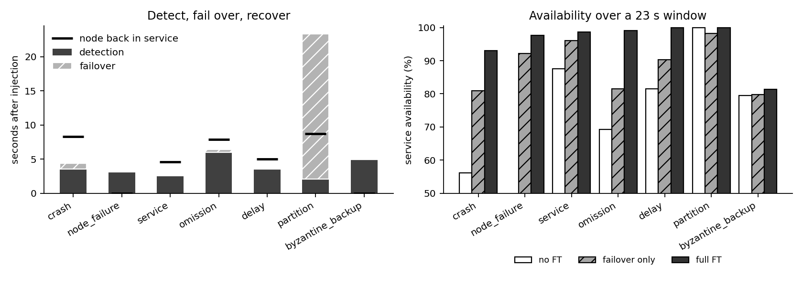
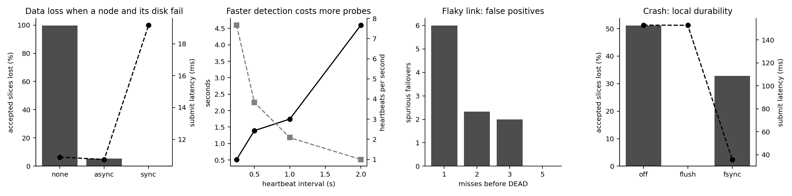

# Milestone 7 - experiment results

All numbers come from `ft_experiments.py` running the master and two workers on one machine (localhost, no network latency). Heartbeat 1 s, DEAD after 3 consecutive misses, probe timeout 0.8 s, async replication every 0.2 s. Values are mean ± standard deviation over the listed number of trials.

## 1. Failure comparison

| Failure | Seen by detector as | Detected | Detection (s) | Failover (s) | Node back in service (s) | Declared dead but alive | Slices lost |
|---|---|---|---|---|---|---|---|
| Crash failure (`crash`) | TIMEOUT | 5/5 | 3.54 ± 0.21 | 4.40 ± 1.47 | 8.30 ± 3.83 | 5/5 | 0 of 482 |
| Node failure (`node_failure`) | TIMEOUT | 5/5 | 3.13 ± 0.29 | 3.17 ± 0.28 | - | 5/5 | 1 of 529 |
| Service failure (`service`) | SERVICE_FAILED | 5/5 | 2.57 ± 0.43 | 2.70 ± 0.53 | 4.61 ± 0.53 | 0/5 | 0 of 540 |
| Omission failure (`omission`) | TIMEOUT | 5/5 | 6.00 ± 2.53 | 6.38 ± 2.88 | 7.91 ± 3.13 | 5/5 | 0 of 466 |
| Communication failure (latency) (`delay`) | TIMEOUT | 5/5 | 3.58 ± 0.25 | 3.71 ± 0.35 | 4.98 ± 0.46 | 5/5 | 0 of 507 |
| Communication failure (partition) (`partition`) | REPLICATION_DEGRADED, TIMEOUT | 5/5 | 2.11 ± 0.67 | 23.35 ± 0.00 | 8.72 ± 0.44 | 1/5 | 0 of 545 |
| Byzantine failure (`byzantine_backup`) | BYZANTINE_SUSPECT, TIMEOUT | 4/5 | 4.93 ± 3.93 | - | - | 1/5 | 0 of 422 |

Trials per failure: 5. All times are measured from the instant of injection. Observation window: 3 s before to 20 s after injection; the injection instant is random within the heartbeat cycle. Node back in service = failback after failover, supervisor restart, replication catch-up or fault expiry, depending on the failure (see `recovery_via` in matrix.csv).

### Availability and recovery time (service level)

Three clients probe the service every 100 ms. **No FT**: talks straight to node1. **Failover only**: follows the detector's node states, one attempt per request. **Full FT**: failover plus retry on the other node. Availability = T_uptime / T_total over the window; MTTR = mean outage length.

| Failure | Availability: no FT | failover only | full FT | MTTR no FT (s) | MTTR failover only (s) | MTTR full FT (s) | p95 request latency, full FT (ms) | Max latency (ms) |
|---|---|---|---|---|---|---|---|---|
| crash | 56.20% | 80.96% | 93.06% | 9.41 ± 6.73 | 2.50 ± 0.50 | 1.21 ± 1.80 | 303 | 577 |
| node_failure | 12.41% | 92.20% | 97.67% | 19.95 ± 0.99 | 1.49 ± 0.50 | 0.36 ± 0.81 | 286 | 569 |
| service | 87.58% | 96.10% | 98.72% | 2.63 ± 0.43 | 0.63 ± 0.45 | 0.29 ± 0.66 | 270 | 697 |
| omission | 69.22% | 81.55% | 99.12% | 5.63 ± 2.32 | 2.22 ± 0.85 | 0.20 ± 0.45 | 357 | 772 |
| delay | 81.46% | 90.25% | 100.00% | 4.02 ± 0.01 | 2.01 ± 0.01 | 0.00 ± 0.00 | 225 | 695 |
| partition | 100.00% | 98.22% | 100.00% | 0.00 ± 0.00 | 0.40 ± 0.55 | 0.00 ± 0.00 | 183 | 647 |
| byzantine_backup | 79.50% | 79.82% | 81.40% | 4.13 ± 7.13 | 4.48 ± 7.95 | 4.39 ± 7.78 | 356 | 584 |

MTTR here is the longest outage seen by that client in the window (one fault per trial, so it is the outage length).

### Example event timeline (node failure, trial 0)

| t (s after injection) | event | node | detail |
|---|---|---|---|
| 0.202 | SUSPECT | node1 | {"cause": "UNREACHABLE"} |
| 2.273 | REPLICATION_DEGRADED | node2 | {"lag_s": 2.026} |
| 2.945 | DEAD | node1 | {"cause": "TIMEOUT", "detect_s": 2.743} |
| 3.01 | FAILOVER_DONE | node1 | {"backup": "node2", "adopted": 18, "promote_ms": 8.36, "rpc_ms": 50.6} |
| 5.0 | RECOVERY_ACTION | node1 | {"action": "restart_service", "ok": false, "attempt": 1} |
| 22.986 | RECOVERY_ACTION | node1 | {"action": "restart_node", "ok": true, "attempt": 2} |

## 2. Availability analysis (soak test)

Random faults (crash, service, node failure, omission, delay) were injected into node1 for 180 s (9 faults, mean gap about 22 s, one at a time) while three clients probed the service every 100 ms. Availability = T_uptime / T_total, where a failed probe counts as downtime.

| | No FT (direct to node1) | Failover only | Full FT (failover + retry) |
|---|---|---|---|
| Availability | 81.927% | 92.003% | 100.000% |
| Downtime (s) | 32.5 | 14.4 | 0.0 |
| Outages | 9 | 9 | 0 |
| MTTR (s) | 3.61 | 1.60 | 0.00 |

Client requests succeeded with full FT: 100.00%. Slices accepted / lost: 861 / 0.

Analytic check with A = MTTF / (MTTF + MTTR), using the measured MTTF:

| Model | Predicted | Measured |
|---|---|---|
| MTTF (s) | 16.4 | |
| Single node: MTTF/(MTTF+MTTR_noFT) | 81.936% | 81.927% |
| Failover only: MTTF/(MTTF+MTTR_failover) | 91.111% | 92.003% |
| Two nodes, instant perfect failover, node2 equally failure-prone: 1-(1-A)^2 | 96.7369% | n/a: only node1 was faulted |

The last row is the ceiling for a pair in which *both* nodes fail at node1's rate and fail independently; node2 was never faulted here, so the measured full-FT availability (100.000%) is limited only by client retries masking each outage and is not comparable with that row. The first two rows validate the model: predicted and measured availability agree to within a few tenths of a percent.

## 3. Design alternatives: reliability vs resource usage

### 3.1 Replication strategy

Steady load of 20 slices/s for 8 s, then a 0.5 s burst of 100 slices/s, then node1 and its disk are lost immediately.

| Replication | Submit latency (ms) | Replication traffic (kB/s) | Worker CPU (ms per s) | Slices lost | Adopted at failover | Service outage (s) |
|---|---|---|---|---|---|---|
| none | 10.88 ± 2.34 | 0.00 ± 0.00 | 124.3 ± 44.9 | 221.3 of 222 (99.7%) | 0.0 ± 0.0 | 0.00 ± 0.00 |
| async | 10.74 ± 1.98 | 4.50 ± 0.10 | 148.4 ± 29.2 | 12.0 of 224 (5.4%) | 211.7 ± 9.7 | 0.00 ± 0.00 |
| sync | 19.17 ± 0.06 | 5.30 ± 0.10 | 235.0 ± 18.5 | 0.0 of 197 (0.0%) | 197.0 ± 6.6 | 0.00 ± 0.00 |

### 3.2 Heartbeat interval (threshold = 3 misses)

| Interval (s) | Detection (s) | Failover complete (s) | Heartbeat messages (per s, 2 nodes) | Idle worker CPU (ms/s) | Service outage (s) |
|---|---|---|---|---|---|
| 0.25 | 0.52 ± 0.12 | -0.39 ± 1.65 | 7.7 | 95.1 ± 49.6 | 0.00 ± 0.00 |
| 0.5 | 1.39 ± 0.23 | 1.49 ± 0.31 | 3.8 | 83.3 ± 39.5 | 0.00 ± 0.00 |
| 1.0 | 1.74 ± 0.70 | 1.87 ± 0.55 | 2.1 | 46.9 ± 6.8 | 0.00 ± 0.00 |
| 2.0 | 4.60 ± 1.61 | 5.26 ± 0.60 | 1.0 | 37.8 ± 11.9 | 0.67 ± 1.16 |

### 3.3 Detection threshold on a flaky link (40% of requests dropped for 20 s, heartbeat 0.5 s)

| Misses before DEAD | DEAD declarations (all spurious: the node never stopped) | Suspicions that cleared | Expected detection of a real failure (s) |
|---|---|---|---|
| 1 | 6.0 ± 3.0 | 0.0 ± 0.0 | about 0.25 (threshold x 0.5 s interval) |
| 2 | 2.3 ± 0.6 | 2.0 ± 1.7 | about 0.75 (threshold x 0.5 s interval) |
| 3 | 2.0 ± 1.0 | 6.3 ± 3.2 | about 1.25 (threshold x 0.5 s interval) |
| 5 | 0.0 ± 0.0 | 11.3 ± 0.6 | about 2.25 (threshold x 0.5 s interval) |

### 3.4 Local durability on a crash (process killed, disk survives)

Steady 20 slices/s, then a 0.5 s burst of 100 slices/s, then a crash of node1 (supervisor restarts it after 1 s). Async replication is on in every row, so the loss shown is what neither the replica nor the disk had.

| Local durability | Submit latency (ms) | p95 (ms) | Worker CPU (ms per s) | Accepted slices lost |
|---|---|---|---|---|
| checkpoint only (0.5 s) | 152.88 ± 196.83 | 347.13 ± 429.70 | 177.1 ± 106.8 | 16.5 of 101 (51.16%) |
| WAL, flush per write | 152.76 ± 218.05 | 222.37 ± 290.35 | 188.4 ± 127.0 | 0.0 of 101 (0.00%) |
| WAL, fsync per write | 35.84 ± 4.52 | 97.63 ± 2.29 | 230.9 ± 148.1 | 48.3 of 145 (32.88%) |

## 4. Byzantine behavior: quorum reads of a replicated register

Every node stores the same value. A client reads all nodes and accepts a value only if a majority of all N nodes return it. 'Wrong' means a lie was accepted; 'no quorum' means the client noticed it could not decide (safe failure).

| Case | Nodes N | Correct | No quorum (detected, undecidable) | Wrong value accepted | Faulty node identified | N >= 3f+1 |
|---|---|---|---|---|---|---|
| 1 Byzantine (random lies) | 2 | 0% | 100% | 0% | 0% | no |
| 1 Byzantine (random lies) | 3 | 100% | 0% | 0% | 100% | no |
| 1 Byzantine (random lies) | 4 | 100% | 0% | 0% | 100% | yes |
| 1 Byzantine (consistent lie) | 2 | 0% | 100% | 0% | 0% | no |
| 1 Byzantine (consistent lie) | 3 | 100% | 0% | 0% | 100% | no |
| 1 Byzantine (consistent lie) | 4 | 100% | 0% | 0% | 100% | yes |
| 1 Byzantine + 1 crashed | 3 | 0% | 100% | 0% | 0% | no |
| 1 Byzantine + 1 crashed | 4 | 0% | 100% | 0% | 0% | no |
| 2 Byzantine colluding | 3 | 0% | 0% | 100% | 0% | no |
| 2 Byzantine colluding | 4 | 0% | 100% | 0% | 0% | no |

Reading the table: reading a value that was already stored identically on all honest nodes needs only a majority (N >= 2f+1), which is why one liar is masked at N = 3. The N >= 3f+1 column is the stricter bound for tolerating f *arbitrary* (Byzantine) nodes in general, including agreeing on a value and surviving crashes on top of lies; it is what breaks in the last rows. With one liar plus one crash, or two colluding liars, 3 or 4 nodes can no longer out-vote the faults: the client either sees no quorum (safe, 4 nodes) or accepts the colluders' lie (unsafe, 3 nodes). Tolerating two Byzantine nodes needs N >= 7.

