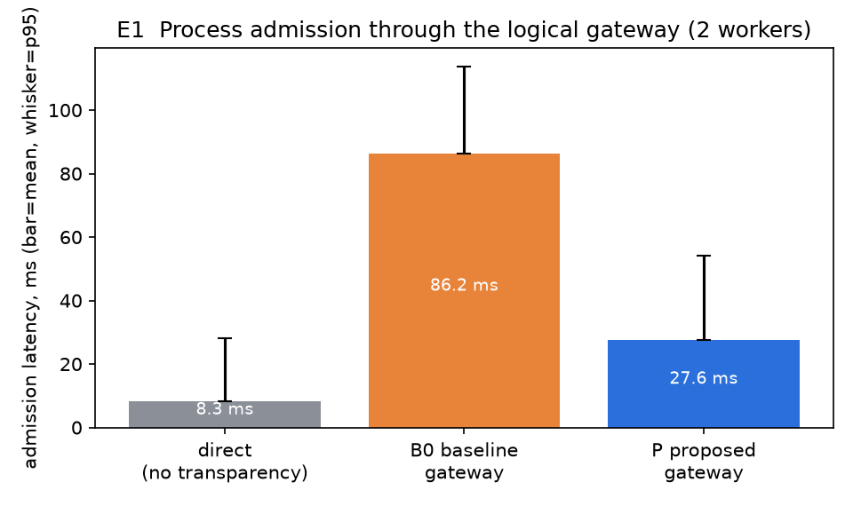
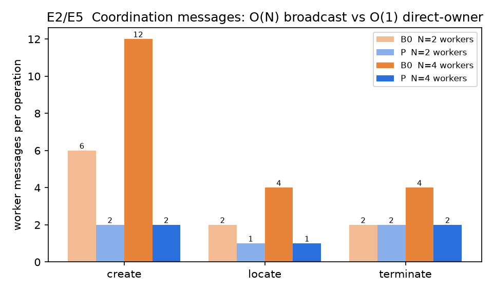
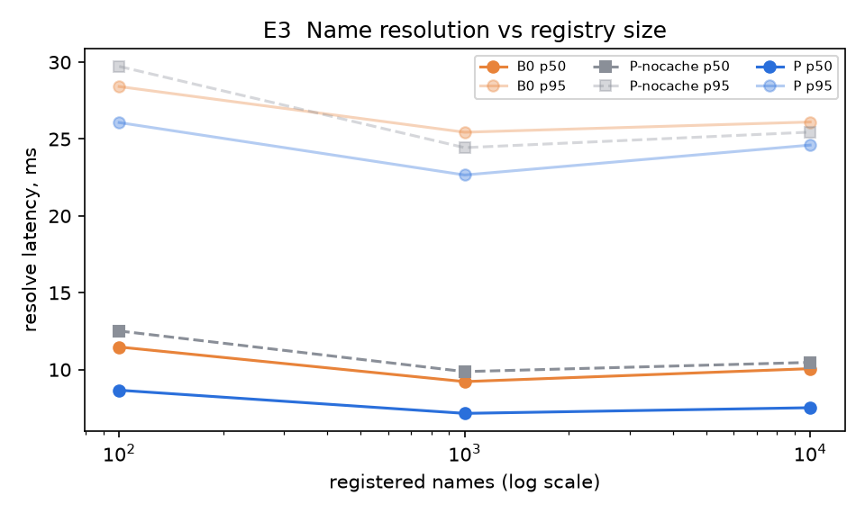
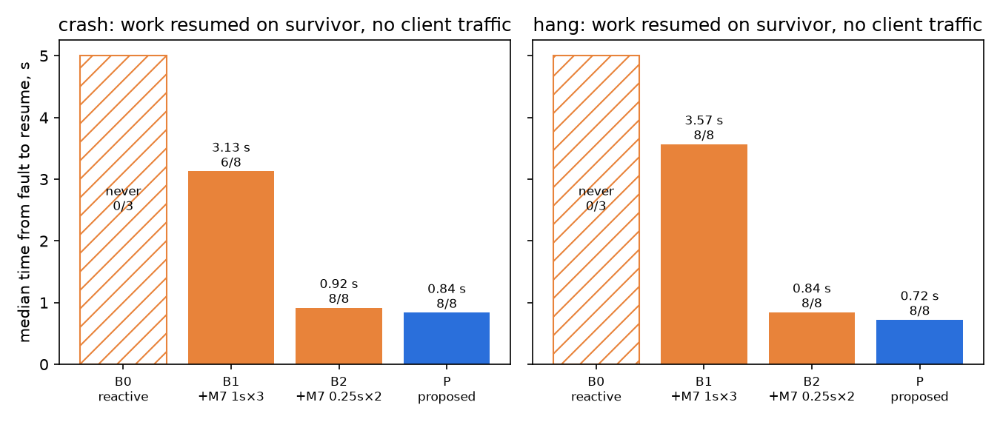
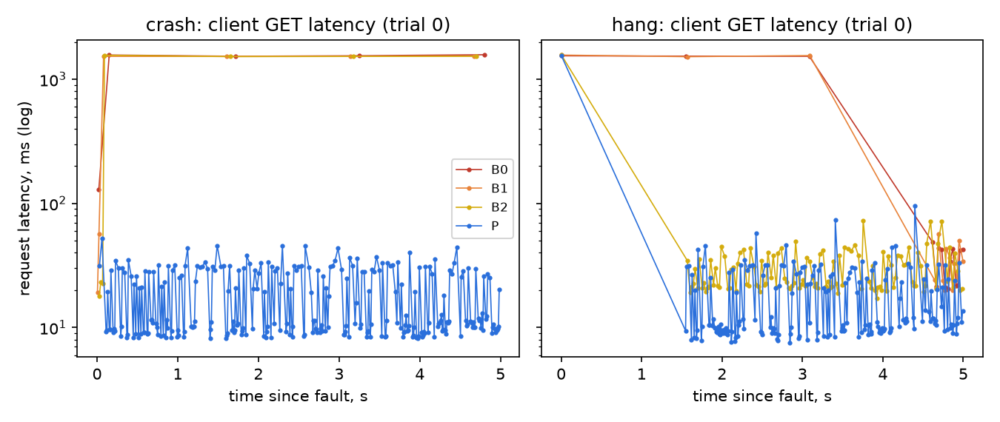

# Milestones 9 & 10: Baseline vs Proposed System

**Research question.** Can the logical gateway hide worker failures and locations (Milestone 9)
and resolve names and manage processes (Milestone 10) at lower latency, with fewer messages,
and without duplicate work, compared with the gateway we already built?

**Answer from the measurements (this host, see Reproducibility).**

| Metric (one row = one client operation unless stated) | Baseline | Proposed | Change |
|---|---:|---:|---:|
| Process admission latency, mean, 2 workers | 86.2 ms | 27.6 ms | −68% |
| Process admission latency, mean, 4 workers | 148.1 ms | 33.2 ms | −78% |
| Worker messages per create, 2 / 4 workers | 6 / 12 | 2 / 2 | O(N) → O(1) |
| Live-process locate latency, mean, 4 workers | 43.8 ms | 17.2 ms | −61% |
| Worker messages per locate, 2 / 4 workers | 2 / 4 | 1 / 1 | O(N) → O(1) |
| Name resolve p50 at 10,000 names | 10.1 ms | 7.5 ms | −25% |
| Time to resume work after a crash, no client traffic (median, B1 = deployed baseline) | 3.13 s (6/8 trials) | 0.84 s (8/8) | 3.7× faster |
| Client requests served in the 5 s after a crash (mean per trial) | 6.0 | 268.9 | 45× |
| Client request latency during a crash outage, p50 | 1,525 ms | 11 ms | |
| Trials ending with the same process running twice (hung worker) | 16/16 | 0/16 | duplicates removed |
| Background heartbeat traffic, 2 workers idle | 2.8 msg/s | 8.0 msg/s | **cost: 2.9× more** |

All raw rows are in the CSV files in this folder; `summary.json` holds every statistic below.

---

## 1. What was built (Existing method ≠ Our implementation ≠ Our contribution)

| | Existing method (literature) | Our baseline (M7 + M9 + M10) | Our proposed contribution |
|---|---|---|---|
| Failure detection | Heartbeat / φ-accrual detectors | M7 `ft_master.py` (1 s, 3 misses) runs **beside** the gateway; the gateway itself only notices failure inside a client request | Heartbeat detector **inside** the gateway, so detection updates the name table and the routing in the same step |
| Failover | Primary-backup replication | Promote **every** standby copy on the backup | Promote only the failed node's replicas (`failed_node`), rebind names to the new owner |
| Rejoin | Fencing (STONITH, epochs) | None: a hung node keeps running promoted work | Fence by **demotion**: the stale copy stops and becomes the new standby (one message) |
| Location / naming | DNS, LDAP, name servers with caches | SQLite name server; every lookup **broadcasts** to all workers | Owner stored in the name table; **direct-owner** routing, broadcast only as fallback; write-through LRU+TTL cache |
| Membership | Static map or leases (e.g. Chubby, etcd) | Static `TRANSPARENCY_NODES` | Static map + runtime registration with **leases** |

Code: `host_pc/proposed_gateway.py`, `host_pc/cached_naming.py`, worker additions in
`worker_vms/worker_node.py` (`failed_node` promotion, `/demote`, request counters; all backwards
compatible). Baseline files `transparency_gateway.py` and `naming_service.py` are unchanged.

## 2. Mathematical model

**Detection bound.** With heartbeat period Δ, K consecutive misses, probe timeout τ, and a tick
that waits for every probe:

  T_detect ≤ Δ + K · max(Δ, τ)

Proposed: Δ = 0.25 s, K = 2, τ = 0.3 s → T_detect ≤ 0.85 s. M7 as deployed: Δ = 1.0 s, K = 3,
τ = 0.8 s → T_detect ≤ 4.0 s. Measured median resume times (detection + promotion) were 0.84 s
and 3.13 s.

**Cost of detection.** Heartbeat traffic = N / Δ messages per second (N workers). Proposed at N = 2:
8 msg/s (measured 8.0). This is the price of faster detection and grows linearly with N.

**Messages per operation** (N workers, replication factor 2):

| Operation | Baseline | Proposed |
|---|---|---|
| Create | N probes + (N−1) replicas + 1 submit + N lookups = **3N** | 1 submit ∥ 1 replica = **2** |
| Locate | **N** (broadcast) | **1** (owner), N on fallback |
| Terminate | **N** | **2** (owner + standby) |

Measured counts match exactly (6/12 vs 2 for create; 2/4 vs 1 for locate; 2/4 vs 2 for terminate).

**Admission latency.** Baseline: probe + replicate + submit + broadcast run in sequence. Proposed:
submit and replicate run in parallel, so latency ≈ max(submit, replicate) + local bookkeeping.

## 3. Experiments

Every experiment ran on the same host, same worker code and capacities, in one run
(`python host_pc/m9_m10_benchmark.py`, 22 Nov 2026, ~20 min). Systems were interleaved request by
request (E1–E3) to cancel drift.

### E1 Admission overhead (M9 overhead analysis)

- **Hypothesis H1:** removing per-request probes and post-submit broadcasts, and running the
  replica write in parallel with the submit, lowers admission latency and makes it independent of N.
- **Design:** independent variable = system (direct worker / B0 / P) and N (2, 4); dependent =
  client latency, worker messages; controlled = payload (zero-cost process, so workers never run
  out of capacity), host, seed 2403. 60 creates per system at N = 2, 30 at N = 4; messages counted
  on the workers over 20 creates.

| N | Path | n | Mean | p50 | p95 | Messages/create |
|---:|---|---:|---:|---:|---:|---:|
| 2 | Direct worker (no transparency) | 60 | 8.3 ms | 5.9 ms | 28.1 ms | 1 |
| 2 | B0 baseline gateway | 60 | 86.2 ms | 81.6 ms | 113.8 ms | 6 |
| 2 | P proposed gateway | 60 | 27.6 ms | 22.7 ms | 54.0 ms | 2 |
| 4 | Direct worker | 30 | 11.2 ms | 8.6 ms | 31.4 ms | 1 |
| 4 | B0 baseline gateway | 30 | 148.1 ms | 143.3 ms | 211.4 ms | 12 |
| 4 | P proposed gateway | 30 | 33.2 ms | 28.7 ms | 63.4 ms | 2 |

- **Analysis:** transparency overhead (gateway minus direct) fell from 78.0 ms to 19.3 ms at N = 2
  (−75%). Going from 2 to 4 workers added 62 ms to the baseline but 5.6 ms to the proposal, because
  its message count does not grow with N. All 360 creates succeeded.
- **Caveat:** the latency gain combines four changes (no per-request probes, parallel fan-out, no
  post-submit broadcast, keep-alive connections); we did not measure each one separately. The
  message counts do not depend on the host; the milliseconds do (Windows localhost connections are
  slow, which is why this baseline is slower than the 35.85 ms recorded under Docker in
  `results/milestone9/`). Compare systems within this run, not across runs.
- **Conclusion:** H1 supported.



### E2 Locate and terminate live processes (M10 resolution latency)

- **Hypothesis H2:** storing the owner in the name table lets a lookup use 1 message instead of N.
- **Design:** 30 long-running processes per system; 150 random locates at N = 2 and 75 at N = 4,
  plus 10 terminations per system.

| N | System | Locate mean | Locate p95 | Terminate mean | Messages locate / terminate |
|---:|---|---:|---:|---:|---:|
| 2 | B0 | 33.9 ms | 57.1 ms | 34.4 ms | 2 / 2 |
| 2 | P | 17.5 ms | 33.5 ms | 20.9 ms | 1 / 2 |
| 4 | B0 | 43.8 ms | 59.0 ms | 56.9 ms | 4 / 4 |
| 4 | P | 17.2 ms | 30.4 ms | 28.7 ms | 1 / 2 |

- **Analysis:** every locate returned `running` (450/450). Proposed locate latency is flat in N
  (17.5 → 17.2 ms) while the baseline grows (33.9 → 43.8 ms). All 225 proposed lookups were served
  by the direct-owner path (`X-Routing: direct_owner`); all 225 baseline lookups broadcast.
- **Conclusion:** H2 supported.



### E3 Name resolution vs registry size (M10 scalability)

- **Hypothesis H3:** a write-through cache keeps resolution flat as the registry grows.
- **Design:** registry grown to 100, 1,000 and 10,000 `service/` names (batches of 500); 300 random
  resolves per size for B0, P, and P with the cache bypassed (`?bypass_cache=1`); then 8 concurrent
  clients for 5 s at 10,000 names.

| Names | B0 p50 / p95 | P (cache) p50 / p95 | P, cache bypassed, p50 / p95 |
|---:|---:|---:|---:|
| 100 | 11.5 / 28.4 ms | 8.7 / 26.1 ms | 12.5 / 29.7 ms |
| 1,000 | 9.2 / 25.4 ms | 7.2 / 22.7 ms | 9.9 / 24.4 ms |
| 10,000 | 10.1 / 26.1 ms | 7.5 / 24.6 ms | 10.5 / 25.5 ms |

Throughput with 8 clients at 10,000 names: B0 118.9 resolves/s, P 129.3 resolves/s (+9%).
Cache: 10,220 entries, 0 evictions, 100% hit rate.

- **Analysis:** all three curves are flat from 100 to 10,000 names: SQLite's index already makes
  a lookup cheap. The cache saves about 2.5 ms per resolve, and connection reuse alone saves
  nothing measurable (bypassed ≈ baseline). Most of the ~10 ms is the HTTP request to the
  single-threaded development web server, not the name lookup.
- **Conclusion:** H3 supported but the effect is small at this scale. The honest lesson: for
  naming, the bottleneck is the gateway's HTTP layer, not the registry. 10× the previous tested
  scale (1,000 names) was reached with no degradation.



### E4 Failure, detection, recovery (M9 failure and migration transparency)

- **Hypothesis H4:** a detector inside the gateway restores work sooner than the deployed
  baseline, keeps client requests fast during the outage, and prevents duplicate execution.
- **Design:** four configurations, each in its own fresh cluster so detectors cannot interfere:

| Config | Components |
|---|---|
| B0 | baseline gateway only |
| B1 | baseline gateway + M7 `ft_master` **as deployed** in docker-compose (1.0 s, 3 misses, 0.8 s timeout) |
| B2 | baseline gateway + `ft_master` **tuned like the proposal** (0.25 s, 2, 0.3 s); isolates timer tuning |
| P | proposed gateway (0.25 s, 2, 0.3 s) |

  Faults on the worker that owns a long-running URLLC process: **crash** (process exits; restarted
  after 4 s) and **hang** (drops every request for 4 s, holding each 2 s). Two modes:
  *silent*, where no client sends requests and an observer polls the surviving worker directly
  until the work is running there (5 s window); and *client*, where one client sends back-to-back
  `GET /api/slices/<id>` for 5 s. 8 trials per cell (3 for B0 silent); after each trial the
  number of workers running the process is counted. 118 trials in total.

**Work resumed on the survivor without client traffic**

| Config | Crash: resumed, median (max) | Hang: resumed, median (max) |
|---|---|---|
| B0 | 0/3, never | 0/3, never |
| B1 | 6/8, 3.13 s (3.47 s) | 8/8, 3.57 s (3.81 s) |
| B2 | 8/8, 0.92 s (0.96 s) | 8/8, 0.84 s (0.92 s) |
| P | 8/8, 0.84 s (0.93 s) | 8/8, 0.72 s (0.89 s) |

**Client view during the outage (5 s window, 8 trials each)**

| Config | Crash: requests served/trial | Crash: latency p50 / p95 | Hang: requests/trial | Hang: latency p50 / p95 |
|---|---:|---:|---:|---:|
| B0 | 6.0 | 1,526 / 1,568 ms | 16.8 | 26 / 1,542 ms |
| B1 | 6.0 | 1,525 / 1,571 ms | 29.4 | 24 / 1,544 ms |
| B2 | 6.4 | 1,524 / 1,554 ms | 119.2 | 24 / 47 ms |
| P | 268.9 | 11 / 36 ms | 189.2 | 11 / 36 ms |

Every client request in every configuration eventually answered `running` (100%), so the
difference is how long each request took.

**Duplicate execution after the faulty worker returns**

| Config | Crash trials with 2 copies running | Hang trials with 2 copies running |
|---|---:|---:|
| B0 | 0/11 | 8/11 |
| B1 | 0/16 | 16/16 |
| B2 | 0/16 | 16/16 |
| P | 0/16 | **0/16** |




**Analysis**

1. **Detection speed is mostly timer tuning.** P resumes work 3.7× faster than the deployed B1
   (0.84 s vs 3.13 s), but B2, the same M7 master with P's timers, gets close (0.92 s). We
   do not claim the faster detection as an architectural contribution; it costs 8.0 vs 2.8
   background messages per second.
2. **The contribution is what the gateway does with the detection.** Even when B1/B2 have
   promoted the replica, the baseline gateway still broadcasts every lookup to the dead worker
   and waits 1.5 s for it: after a crash only ~6 requests per 5 s get through, at 1.5 s each. The
   proposed gateway rebinds the name to the new owner, so requests take 11 ms (p50) and 45× more
   requests are served. For a URLLC slice with a millisecond budget, the baseline's failure is
   "transparent" in correctness but not in latency.
3. **Fencing removes duplicate work.** A hung worker is not dead: when it returns it still runs
   the process that was promoted elsewhere. Every baseline hang trial in which a standby was
   promoted ended with two copies running (40/40: B0 client mode, B1, B2). Demotion on rejoin gave
   0/16.
4. **Two baseline defects found by the experiment.** (a) VERIFIED: if a crashed worker restarts
   before any client asks, B0 never promotes the standby: the process stays `replicated` forever
   (0/3 resumed; a follow-up check returned `replicated` on 3/3 requests after the restart).
   (b) B1 missed 2 of 8 crashes: the M7 master still had the node marked DEAD from the previous
   trial (its restart/failback cycle had not finished), so the next crash raised no new alarm and
   the process ended with 0 copies running. Faults arrived ~9 s apart.
5. **What did not improve.** The client request that is in flight when a worker hangs waits the
   full 1.5 s timeout in every configuration including P (first successful answer at 1.56 s
   median for all). Shortening it is a timeout trade-off, not an architecture change.

- **Conclusion:** H4 supported for client-visible failure transparency and duplicate prevention;
  for raw detection speed only against the deployed configuration, not against a tuned one.

## 4. Transparency checklist (brief section 4.9)

| Transparency | How the proposed gateway provides it | Evidence |
|---|---|---|
| Access | One API for slices/processes/names regardless of worker | `test_lifecycle_on_both_gateways` |
| Location | Responses carry logical URIs only; owner kept internal (`X-Routing` header names the path type, never the node) | `test_location_is_hidden` |
| Replication | Synchronous standby on create; replica re-created on rejoin | `replication: synchronous`; `test_proactive_failover_and_rejoin` |
| Migration | Name rebinding after failover or overflow; client keeps the same URI | E4, 100% client answers |
| Failure | Detector promotes and rebinds without a client request | E4 silent mode, 16/16 |

## 5. Limitations

- **Single gateway.** The proposed gateway is still one process; its loss stops new requests. Its
  ownership map is in memory and rebuilt by broadcast after a restart. A replicated gateway
  (Raft/etcd-backed name table) is the natural next step.
- **At-least-once execution.** Replicas are admission snapshots; a promoted process restarts from
  its accepted state. Fencing stops duplicates after rejoin, not during a network partition in which
  both copies run.
- **A worker restarted faster than T_detect (< 0.85 s)** is never seen as failed, so the proposed
  gateway would also leave its standby unpromoted (same defect as B0, much smaller window).
- **Host.** One Windows machine, loopback network; latencies are environment-specific, message
  counts are not. No real network delay, loss or bandwidth limit was injected in these runs.
- **Sample sizes.** 8 trials per failover cell: enough to separate 0.8 s from 3 s and 11 ms from
  1.5 s, not enough to separate P from B2 on detection time.
- **Scale.** Tested up to 4 workers and 10,000 names. Heartbeat cost grows as N/Δ; at 100 workers
  it would be 400 msg/s, where gossip or hierarchical detection would be needed.

## 6. Reproducibility

| Item | Value |
|---|---|
| Hardware | AMD64 Family 23 Model 17 (8 logical CPUs) |
| OS | Windows 11 Pro 10.0.22621 |
| Network | all processes on 127.0.0.1, HTTP/1.1 |
| Language / frameworks | Python 3.13.5, Flask 3.0.0, requests 2.31.0, prometheus_client 0.19.0, kafka-python ≥ 2.0.3 (Kafka disabled), matplotlib |
| Workers | edge 4 CPU / 1024 MB, core 8 CPU / 2048 MB, cloud1/cloud2 8 CPU / 2048 MB; scheduler tick 1 s |
| Gateway timeouts | worker calls 1.5 s (both gateways); proposed heartbeat Δ 0.25 s, K 2, τ 0.3 s |
| Workload | E1/E2 zero-cost processes (burst 100,000); E4 URLLC process, 1 CPU, 64 MB; random seed 2403 |
| Runtime | ~20 minutes for everything |

```sh
python -m venv venv && venv/Scripts/pip install flask==3.0.0 requests==2.31.0 prometheus_client==0.19.0 "kafka-python>=2.0.3" matplotlib
venv/Scripts/python -m unittest tests/test_m9_m10_integration.py -v     # 6 integration tests, ~30 s
venv/Scripts/python host_pc/m9_m10_benchmark.py                          # this report's data + figures
venv/Scripts/python host_pc/demo_failover.py                             # live Part E demo
```

On Linux/macOS use `venv/bin/python`. Docker users can run the proposed gateway beside the
baseline with `docker compose -f docker-compose.yml -f docker-compose.m9m10.yml up -d --build`
(gateway on :5101); the numbers above were produced with the local runner, not Docker.
